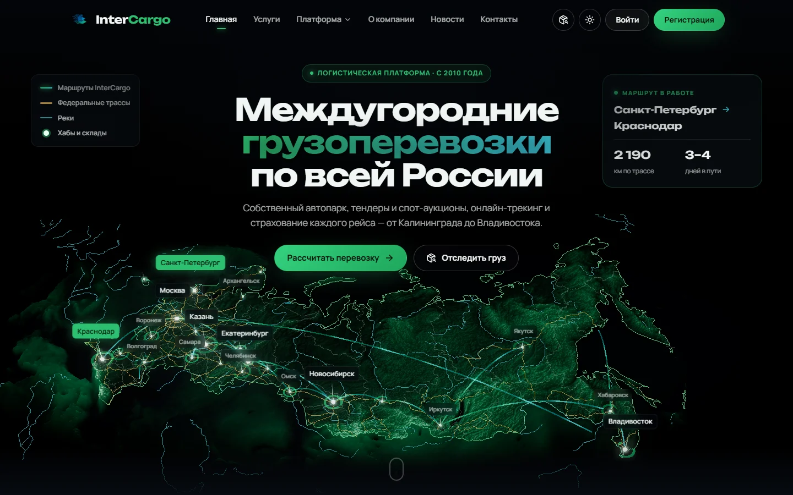
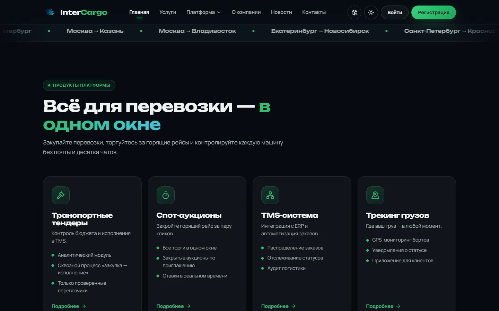
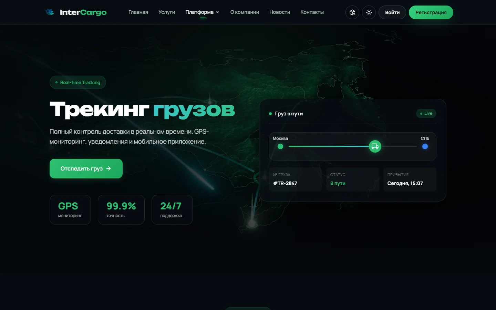
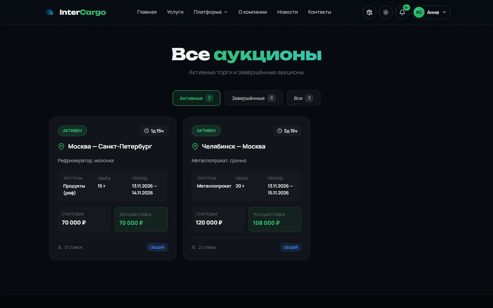
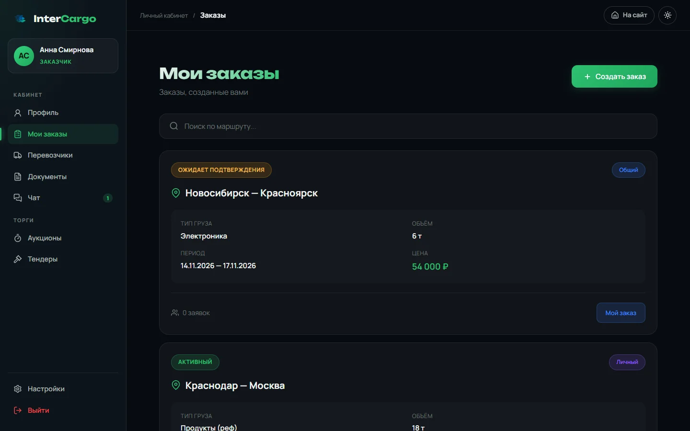

# InterCargo

Fullstack-платформа междугородних грузоперевозок: заказчики публикуют заказы и аукционы,
перевозчики откликаются и торгуются, стороны договариваются в чате. На главной — интерактивная
3D-карта России с рельефом, реками, федеральными трассами и маршрутами компании.



---

## Возможности

* **3D-карта маршрутов** (three.js): рельеф по реальным высотам, реки, трассы, границы регионов,
  50+ городов, анимированные маршруты с грузовиками, подсветка маршрутов города при наведении
* Регистрация и вход (JWT), роли: заказчик, перевозчик, администратор
* **Заказы**: создание, модерация публичных заказов, отклики перевозчиков, выбор исполнителя
* **Аукционы**: публичные и закрытые (по приглашению), ставки на понижение, автозавершение по времени
* **Чат** между заказчиком и выбранным перевозчиком: текст и голосовые сообщения
* **Уведомления**: новые заявки, перебитые ставки, решения по заказам, сообщения
* Отзывы о перевозчиках, админ-панель с блокировкой пользователей
* Заявка на расчёт и подписка на новости (письма — если настроен SMTP)
* Тёмная и светлая тема, адаптивная вёрстка

| | |
|---|---|
|  |  |
|  |  |

---

## Стек

**Frontend:** Vue 3, Vue Router, Pinia, Vite, three.js, lucide-vue-next, Vitest
**Backend:** Node.js, Express, MongoDB, Mongoose, JWT, Jest + Supertest + mongodb-memory-server

```text
Backend/
├── app.js              Express-приложение (маршруты, CORS, обработка ошибок)
├── server.js           подключение к MongoDB и запуск
├── middleware/         auth, requireAdmin
├── models/             User, Order, Auction, Chat, Review, Notification, ...
├── routes/             auth, orders, auctions, chats, notifications, reviews, users, contact
├── scripts/make-admin.js
└── __tests__/

frontend/intercity-cargo-delivery/src/
├── api/client.js       единая точка запросов к API
├── components/         3D-карта, форма заявки
├── data/               подготовленные данные карты, новости
├── pages/ features/    страницы
├── stores/             Pinia
└── ui/                 шапка, подвал, макет кабинета
```

---

## Запуск локально

Нужны Node.js 20+ и MongoDB.

```bash
cd Backend
cp .env.example .env      # укажите MONGO_URI и JWT_SECRET
npm install
npm run dev
```

```bash
cd frontend/intercity-cargo-delivery
npm install
npm run dev
```

Фронтенд по умолчанию ходит на `http://localhost:4000`. Другой адрес API задаётся переменной
`VITE_API_URL` (например, в `frontend/intercity-cargo-delivery/.env.local`).

### Администратор

Роль администратора не выдаётся при регистрации. Зарегистрируйтесь обычным способом, затем:

```bash
cd Backend
npm run make-admin -- you@example.com
```

### Тесты

```bash
cd Backend && npm test
cd frontend/intercity-cargo-delivery && npm test
```

---

## Деплой

* **API** — `render.yaml` в корне описывает бесплатный веб-сервис Render. Нужны переменные
  `MONGO_URI` (например, бесплатный кластер MongoDB Atlas) и `CLIENT_URL` — адрес фронтенда.
* **Фронтенд** — Vercel, корневая папка `frontend/intercity-cargo-delivery`. В настройках проекта
  задайте `VITE_API_URL` = адрес API. `vercel.json` отдаёт `index.html` для всех путей,
  поэтому прямые ссылки и обновление страницы работают.

---

## API (основное)

```http
POST /api/auth/register      POST /api/auth/login       GET/PUT /api/auth/me
GET  /api/orders             POST /api/orders           POST /api/orders/:id/apply
POST /api/orders/:id/approve|reject                     (админ)
POST /api/orders/:id/applicants/:applicantId/approve|reject
GET  /api/auctions[/active|/my|/:id]                    POST /api/auctions
POST /api/auctions/:id/bid|complete|cancel              DELETE /api/auctions/:id
GET  /api/chats              POST /api/chats/:id/messages  POST /api/chats/:id/close
GET  /api/notifications      POST /api/notifications/read-all
GET  /api/reviews/my         GET /api/reviews/carrier/:id  POST /api/reviews
POST /api/contact/offer-request   POST /api/contact/subscribe
```

---

## Данные карты

* Границы, береговая линия, реки, озёра, трассы, регионы — [Natural Earth](https://www.naturalearthdata.com/) (общественное достояние)
* Рельеф — [Terrain Tiles](https://registry.opendata.aws/terrain-tiles/) на AWS Open Data
  (источники: SRTM, GMTED, ETOPO1 и др.)

Данные заранее спроецированы и упакованы в `src/data/russia-map.json` и `src/assets/map/`.

## Лицензия

MIT
